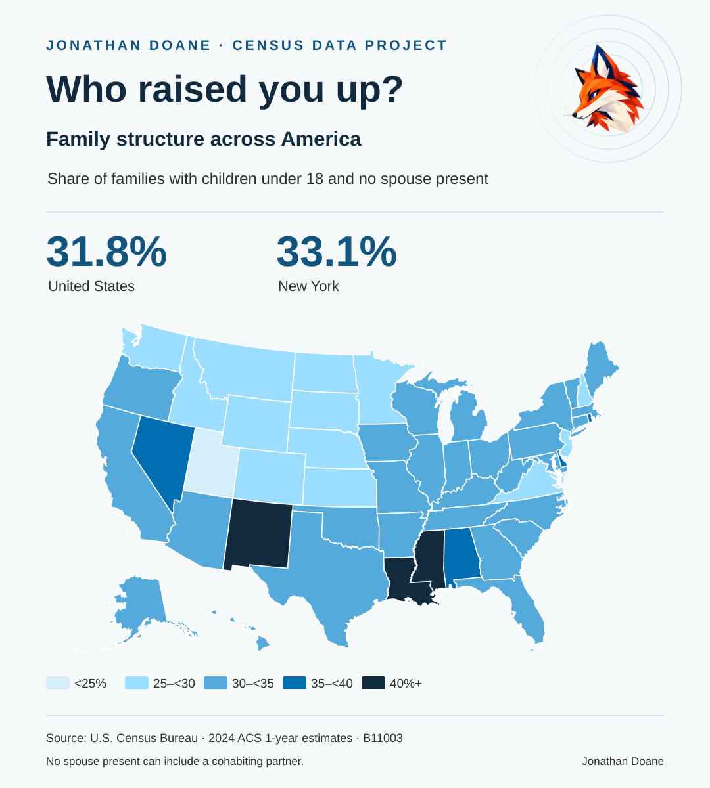

# Who raised you up?

[Explore the interactive map](https://jonathandoanephd.github.io/who-raised-you-up/)

A Census data project by Jonathan Doane. Compare family structure across all 50 states and Washington, D.C., and read stories about the people who helped others find their footing.

Select a state or an estimate range to explore the map. The orange star marks Jonathan’s New York story.

The map uses the U.S. Census Bureau’s [2024 American Community Survey, table B11003](https://data.census.gov/table/ACSDT1Y2024.B11003). It shows the share of families with their own children under 18 whose householder had no spouse present. Other adults may be present in those households.

The standalone `index.html` also opens directly in a browser and works offline.
